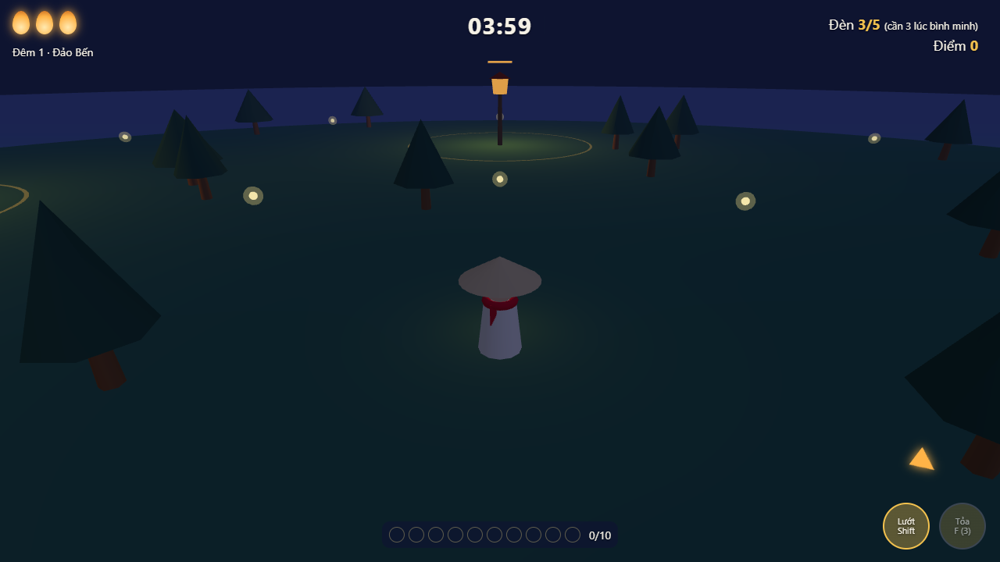
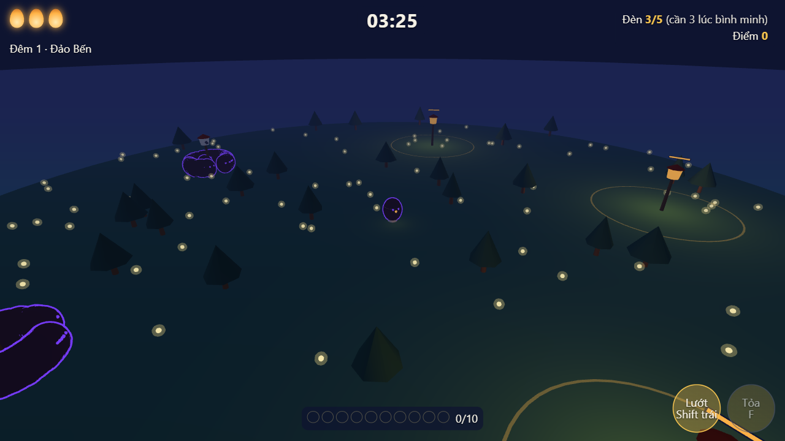

# Đảo Đèn Lồng

> **Video demo:** [Release v1.0.0 — demo.mp4](https://github.com/cuong281/K5-L3A-DAY12-DangDucCuong-2A202603680-AI-SDLC-Dao-Den-Long/releases/tag/v1.0.0) · Tải bản chơi được: [Releases](https://github.com/cuong281/K5-L3A-DAY12-DangDucCuong-2A202603680-AI-SDLC-Dao-Den-Long/releases) · Tài liệu lab: [docs/lab/README.md](docs/lab/README.md)

Đảo Đèn Lồng là game 3D góc nhìn thứ ba chạy trên trình duyệt. **Mây**, người giữ đèn nhỏ tuổi đội nón lá, phải gom đom đóm để thắp và **giữ cho các Đèn Lồng Lớn còn sáng tới bình minh** qua ba đêm: Đảo Bến, Đảo Cau và Đảo Chuông. Trong sương có **Bóng Mực** hút dầu đèn và **Gió Lạc** cướp đom đóm.

Game có chế độ headless tất định theo **Test Contract v1.3**, kèm benchmark, soak test và bảng xếp hạng cục bộ.




## Yêu cầu hệ thống

- macOS, Linux hoặc Windows. Cần **Node.js ≥ 18** (đã thử với 20 và 22).
- Một trình duyệt có WebGL. Chrome hoặc Edge mới là tốt nhất.
- Benchmark cần **Google Chrome hoặc Chromium** đã cài sẵn (đặt `CHROME_PATH` nếu cài ở chỗ khác).
- Máy chạy thử: Ryzen 5 5600H, GPU tích hợp Radeon, 16 GB RAM. Đo được khoảng 130–190 FPS ở cảnh bench.

## Cài đặt và chạy (3 lệnh)

```bash
git clone https://github.com/cuong281/K5-L3A-DAY12-DangDucCuong-2A202603680-AI-SDLC-Dao-Den-Long.git dao-den-long && cd dao-den-long
npm install
npm start            # = node play.js: build nếu cần, mở http://localhost:5173, lưu bảng xếp hạng ra đĩa
```

Bản Release v1.0.0 (thư mục web tĩnh):
1. Giải nén `dao-den-long-v1.0.0-web.zip`.
2. Chạy `npx serve dist` hoặc `python3 -m http.server -d dist 8000`.
3. Mở địa chỉ server in ra.

Khi chạy kiểu này, bảng xếp hạng lưu trong `localStorage` của trình duyệt (vẫn nằm trên đĩa, vẫn còn sau khi tắt và mở lại).

## Điều khiển (đổi được trong Cài đặt → Đổi phím)

| Mặc định | Hành động |
|---|---|
| `W A S D` (hoặc `↑ ↓`) | Đi theo hướng camera |
| Kéo chuột, `Q` / `C`, `← →` | Xoay camera |
| `Space` | Nhảy |
| `Shift` | Lướt |
| `E` | Tương tác: nạp, thắp lại, châm dầu cho đèn |
| `F` | Tỏa Sáng (tốn 3 đom đóm) |
| `Esc` | Tạm dừng: Tiếp tục / Chơi lại Đêm / Cài đặt / Về menu |

Cài đặt (đều được lưu lại):
- Âm lượng và độ nhạy chuột.
- Bảng màu dễ phân biệt cho người mù màu.
- Giảm chuyển động: tắt rung camera và chớp màn hình.
- Chữ lớn (×1.25).
- Đổi phím: báo khi trùng phím, có nút khôi phục mặc định.

Phụ đề và chỉ báo hình ảnh hiện khi Bóng Mực xuất hiện (kèm mũi tên ở mép màn hình), khi gió sắp thổi, trong 10 giây cuối và khi đèn có dầu dưới 30.

## Luật và điểm

- Mang tối đa 10 đom đóm, cộng thêm 2 sau mỗi lần thắp thành công (tối đa 20).
- Đèn cần 10 đom đóm để thắp lần đầu, 5 để thắp lại. Đèn đang sáng hao 1 dầu/s; mỗi đom đóm châm thêm 10 dầu.
- Đèn dưới 30 dầu mất vùng an toàn, và Bóng Mực sẽ tới hút dầu.
- **Thắng** khi còn sống lúc bình minh và đang có ít nhất 3/5, 4/6 hoặc 5/7 đèn sáng (Đêm dài 4:00 / 4:30 / 5:00). **Thua** khi hết 3 Ngọn Lửa, hoặc bình minh tới mà chưa đủ đèn.

| Sự kiện | Điểm |
|---|---|
| Mỗi đom đóm nạp vào đèn | +5 |
| Thắp lần đầu / thắp lại | +100 / +40 |
| Mỗi Bóng Mực trúng Tỏa Sáng (đang hút dầu) | +5 (+15) |
| Bình minh khi thắng: mỗi đèn đang sáng | +50 + floor(dầu) |
| Bình minh khi thắng: mỗi Ngọn Lửa còn lại | +50 |

Tổng điểm là tổng của các Đêm đã thắng. Sau màn Bình Minh, hoặc khi thua ở bất kỳ Đêm nào, bạn có thể nhập tên để lưu vào **Bảng xếp hạng** (top 10, mở từ menu).

## Test, headless, bench, soak

```bash
npm test                                           # 56 unit/CLI tests (node:test)
npm run proof -- phase-4                           # 29 headless scenarios, each run twice (determinism) -> docs/proof/phase-4/
node headless.js --seed 1 --night 1 --ticks 600 --out out/run.jsonl [--scenario f] [--inputs f] [--snapshot-every n]
node tools/bench.js --seed 42 --duration 30 --out bench.json                 # bench_cmd (opens Chrome 1280x720)
node --expose-gc --lite-mode tools/soak.js --seed 7 --nights 10 --out soak.json   # soak_cmd
node play.js --export-leaderboard out.json         # {"entries": [...]} sorted, top 10
```

- **Bench:** chạy cảnh chuẩn của Ticket-04 trong một cửa sổ Chrome thật 1280×720 (không toàn màn hình).
  - Tắt vsync bằng `--disable-gpu-vsync --disable-frame-rate-limit`.
  - 3 s khởi động, sau đó đo đúng `--duration` giây.
  - `peak_mem_mb` là tổng RSS (working set trên Windows) của cả cây tiến trình Chrome.
- **Soak:** chạy 10 Đêm trong một tiến trình. Cờ `--lite-mode` tắt trình biên dịch tối ưu của V8. Nếu không tắt, RSS dao động theo bộ nhớ mã JIT dù heap JS vẫn phẳng ([bằng chứng](docs/proof/phase-4/soak-memprobe.txt)).
- **Kết quả đã commit:** [bench.json](bench.json), [soak.json](soak.json).

## Test Contract

[game.contract.json](game.contract.json) (v1.3) chứa `build_cmd`, `run_cmd`, `headless_cmd`, `bench_cmd`, `soak_cmd` và toàn bộ tuning chuẩn. Logic game nằm trong `src/sim/` (thuần, tất định, không phụ thuộc DOM).

## Sáng tạo của tôi

Mọi phần thêm đều chỉ ở renderer (`src/web/`), nên đầu ra headless không đổi. Cảnh bench không phát sinh sự kiện nào, nên các hiệu ứng này không ảnh hưởng số đo.

- **Đèn trời:** bay lên mỗi khi thắp hoặc thắp lại đèn.
- **Chuông ngũ cung và nhạc nền đêm:** toàn bộ tạo bằng WebAudio, không dùng file âm thanh.
- **Ông Đăng:** dặn dò riêng ở đầu mỗi Đêm.
- **Lá bay báo gió** ở Đêm 3.

Bằng chứng phần cũ vẫn đúng: [docs/proof/phase-4/](docs/proof/phase-4/README.md).

## Tài liệu

- **Bằng chứng và ghi chép theo phase:** [docs/proof/](docs/proof/), [docs/notes/](docs/notes/) (giả định, acceptance criteria, nhật ký AI).
- **Quyết định thiết kế và thay đổi:** [ADR](docs/adr/), [CHANGELOG.md](CHANGELOG.md).
- **Retro:** [docs/notes/retro.md](docs/notes/retro.md).
- **Bản quyền:** [CREDITS.md](CREDITS.md), [LICENSE](LICENSE).
- **Harness AI:** [AGENTS.md](AGENTS.md) (CLAUDE.md trỏ tới), [.claude/settings.json](.claude/settings.json) (Stop hook chặn kết thúc khi test đỏ), [skill verify-headless](.claude/skills/verify-headless/SKILL.md), CI tại [.github/workflows/test.yml](.github/workflows/test.yml).
